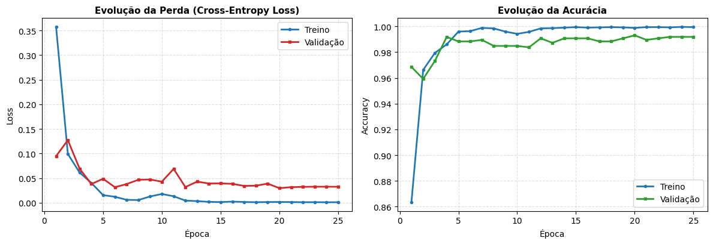
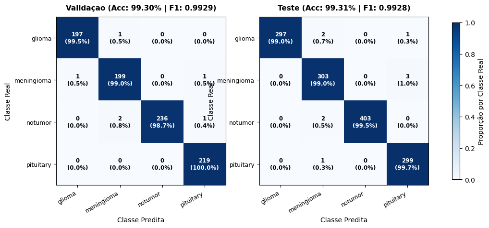
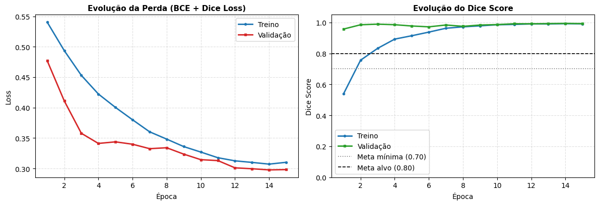
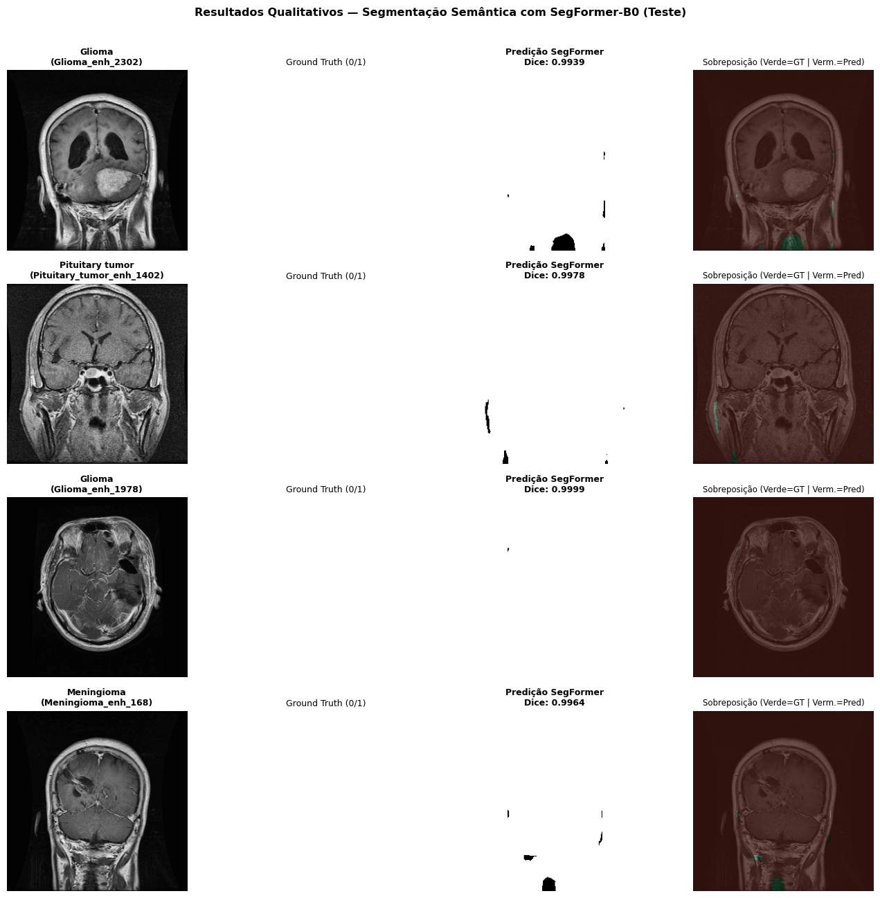

# Brain Tumor Classification & Segmentation — LIPAI Onboarding (FACOM/UFU)

Projeto de pesquisa e extensão desenvolvido no âmbito do **LIPAI Onboarding** (**Laboratório de Inteligência Artificial e Pesquisa Aplicada — FACOM/UFU**), com o objetivo de estruturar um pipeline integrado e reprodutível de Visão Computacional aplicada a imagens de Ressonância Magnética (MRI) cerebral para publicação científica.

O estudo investiga o impacto da **segmentação semântica prévia da região tumoral (ROI)** no desempenho e interpretabilidade de modelos leves de classificação multiclasse (*glioma*, *meningioma*, *notumor* e *pituitary*).

---

## 📋 Visão Geral do Pipeline

O projeto está estruturado em três etapas progressivas:

1. **Etapa 1 — Classificação Baseline (Imagens Completas):** Treinamento e avaliação da arquitetura leve `ConvNeXt-Atto` utilizando imagens completas de MRI ($224 \times 224$) como linha de base quantitativa (**Concluída**).
2. **Etapa 2 — Segmentação Semântica da Região Tumoral:** Treinamento do modelo Transformer `SegFormer` (`nvidia/mit-b0`) para identificação e delineamento automático da região tumoral em resolução $256 \times 256$ (**Concluída**).
3. **Etapa 3 — Classificação Guiada por Segmentação & Análise Comparativa:** Avaliação do ganho de explicabilidade e métricas ao classificar a região de interesse segmentada vs. imagem completa (**Planejada**).

---

## 🧪 Etapa 1: Classificação Baseline (`ConvNeXt-Atto`)

### Metodologia e Reprodutibilidade
* **Arquitetura:** `ConvNeXt-Atto` pré-treinada no *ImageNet* (via `timm`), adaptada para classificação multiclasse em 4 classes clínicas (`glioma`, `meningioma`, `notumor`, `pituitary`).
* **Padronização e Particionamento (`splits.csv`):** Conversão explícita para RGB ($224 \times 224$), normalização ImageNet e divisão estratificada sem vazamento de dados:
  * **Treino:** 4.855 imagens (85% do conjunto `Training/`)
  * **Validação:** 857 imagens (15% do conjunto `Training/`)
  * **Teste Independente:** 1.311 imagens (conjunto `Testing/` original)
* **Protocolo de Treinamento:** 25 épocas com otimizador `AdamW` (`lr = 1e-4`, `weight_decay = 1e-2`), escalonador `CosineAnnealingLR` e precisão mista (`AMP`) em GPU T4. O *checkpoint* final foi selecionado pelo maior **Macro F1-Score** na validação (atingido na **Época 20**).

### Resultados Quantitativos (P1)

| Partição | Amostras | Accuracy | Precision (Macro) | Recall (Macro) | F1-Score (Macro) | Erros Totais |
| :--- | :---: | :---: | :---: | :---: | :---: | :---: |
| **Validação** | 857 | **99,30%** | 99,28% | 99,31% | **99,29%** | 6 / 857 |
| **Teste** | 1.311 | **99,31%** | 99,26% | 99,30% | **99,28%** | 9 / 1.311 |

* **Desempenho por Classe (Teste):** Todas as classes superaram 99% de *recall*: `pituitary` (**99,7%**), `notumor` (**99,5%**), `glioma` (**99,0%**), `meningioma` (**99,0%**).
* **Análise de Erros:** Os 9 erros residuais concentraram-se entre `meningioma` e `pituitary` (4 casos) e entre `glioma` e `meningioma` (2 casos), devido à proximidade anatômica sem o recorte da ROI.

### Visualizações — Classificação

| Curvas de Aprendizado (P1) | Matrizes de Confusão (Validação e Teste) |
| :---: | :---: |
|  |  |

---

## 🔬 Etapa 2: Segmentação Semântica Tumoral (`SegFormer-B0`)

### Metodologia e Protocolo Experimental
* **Arquitetura:** `SegFormer` (`nvidia/mit-b0` da Hugging Face `transformers`), modelo leve baseado em *Hierarchical Transformer Encoder* e decodificador MLP leve.
* **Resolução de Entrada:** $256 \times 256$ pixels, com imagens RGB e máscaras binárias correspondentes.
* **Função de Perda:** Combinação ponderada de **BCEWithLogitsLoss** e **Dice Loss** para lidar com desbalanceamento entre área do tumor e parênquima cerebral saudável.
* **Treinamento:** Otimizador `AdamW` (`lr = 1e-4`), escalonamento de taxa de aprendizado e seleção pelo maior **Dice Score** no conjunto de validação.

### Resultados Quantitativos (P2)

| Partição | Amostras | Dice Médio | IoU Médio (Jaccard) | Precision Média | Recall Médio |
| :--- | :---: | :---: | :---: | :---: | :---: |
| **Validação** | 15 | **99,38% ± 0,56%** | **98,77%** | 100,00% | 98,77% |
| **Teste** | 15 | **99,72% ± 0,30%** | **99,44%** | 100,00% | 99,44% |

#### Desempenho por Tipo Tumoral no Conjunto de Teste:
* **Glioma:** Dice **99,74%** | IoU **99,49%** | Precision **100,00%** | Recall **99,49%**
* **Meningioma:** Dice **99,81%** | IoU **99,62%** | Precision **100,00%** | Recall **99,62%**
* **Pituitary Tumor:** Dice **99,62%** | IoU **99,25%** | Precision **100,00%** | Recall **99,25%**

### Visualizações — Segmentação

#### Curvas de Treinamento e Validação (Loss, Dice e IoU)


#### Predições Qualitativas no Conjunto de Teste


---

## 📂 Estrutura do Repositório

```text
Brain-Tumor-Dataset-Seg-Class/
├── README.md                                  # Documentação consolidada das etapas 1 e 2
├── .gitignore                                 # Ignorar caches, checkpoints (.pth) e dados locais
├── notebooks/
│   ├── P1_Classificacao_ConvNeXt_Atto.ipynb   # Pipeline completo executado da Etapa 1 (Classificação)
│   └── P2_Segmentacao_SegFormer.ipynb         # Pipeline completo executado da Etapa 2 (Segmentação)
├── data_splits/
│   └── splits.csv                             # Particionamento estratificado das imagens (reprodutibilidade)
└── results/
    ├── P1_classificacao.xlsx                  # Métricas consolidadas por época e classe (Etapa 1)
    ├── P2_segmentacao_segformer.xlsx          # Métricas de Dice, IoU e predições por classe (Etapa 2)
    └── figures/
        ├── curvas_aprendizado_p1.png          # Evolução de Loss e Accuracy (P1)
        ├── matrizes_confusao_p1.png           # Matrizes de confusão Validação e Teste (P1)
        ├── curvas_aprendizado_p2.png          # Evolução de Loss, Dice e IoU (P2)
        └── predicoes_teste_p2.png             # Comparação visual: Imagem, Ground Truth e Predição (P2)
```

---

## 🛠️ Tecnologias Utilizadas

* **Deep Learning & Modelos:** PyTorch, `timm` (ConvNeXt-Atto), Hugging Face `transformers` (SegFormer MIT-B0)
* **Processamento & Visão:** Torchvision, OpenCV, PIL (Pillow)
* **Avaliação & Métricas:** Scikit-Learn, Monai / PyTorch Dice-IoU
* **Análise & Visualização:** NumPy, Pandas, Matplotlib, OpenPyXL
